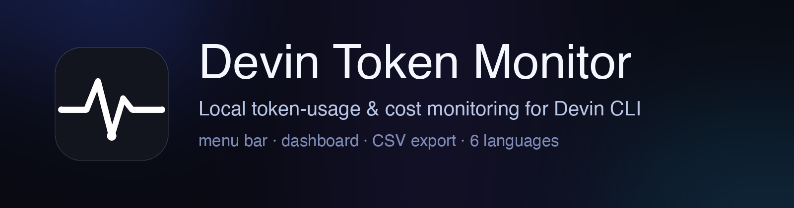

<div align="center">
  

  <p><a href="../README.zh-CN.md">简体中文说明</a></p>
  <p><i>Local Devin CLI token usage and estimated cost, inside your editor.</i></p>
</div>

# Devin Token Monitor for VS Code

A desktop VS Code extension that brings the Devin Token Monitor dashboard into VS Code and compatible IDEs. It reads the local Devin CLI SQLite database in read-only mode and reuses this project's existing aggregation, deduplication, pricing, and lazy response-body logic.

## Requirements

- VS Code 1.90 or later, or a compatible desktop VS Code-based IDE
- Python 3.10+ available on the local machine
- Devin CLI usage data at `%APPDATA%\Devin\cli\sessions.db` (Windows) or `~/.local/share/devin/cli/sessions.db` (macOS/Linux) — auto-detected; or configure the database path

The extension runs as a **UI extension** so the Python worker accesses the local machine's Devin data even when the editor is connected to a remote workspace. Browser-only editors (`vscode.dev`, `github.dev`) are not supported because they cannot spawn the local Python worker or access a local SQLite file.

## Install

Install from the Extensions view when available, or use **Extensions: Install from VSIX…** with the `.vsix` file attached to a GitHub release. Cursor uses Open VSX for marketplace discovery; installing a VSIX manually is the fallback if the extension is not listed. Compatibility with Windsurf and other forks depends on their current extension-install policy and VS Code API version.

After installation, run **Devin Token Monitor: Open Dashboard** from the Command Palette. The status bar can show today’s estimated cost, tokens, request count, or cache read share. The dashboard uses the International Typographic Style with a flat navigation rail, aligned numeric columns, and ruled charts. The system palette pairs warm white and ink with a vermilion accent. It includes nine persistent color themes and an Insights page for rolling-period usage, month-end run-rate projections, estimated cache savings, model efficiency, and request-size/latency percentiles.

### Explore usage

In **Insights**, choose a date range and optionally a model. The totals, token breakdown, daily chart, model costs and ten highest-cost sessions all use that selection. Totals cover the full local database after duplicate request IDs have been removed. The reference section below the report retains the rolling summaries, forecast and performance samples.

**Requests** searches session titles, model names and IDs across the latest 5,000 requests. Use the page controls to browse 50 at a time, or sort by time, cost, token count or duration. Open a row to see cache writes, latency and the reply. The CSV archive retains the snapshot limits for request and session details.

## Configuration

| Setting | Default | Description |
|---|---|---|
| `devinTokenMonitor.pythonPath` | `python3` / `python` | Python 3.10+ executable. |
| `devinTokenMonitor.databasePath` | Devin CLI default | Override the `sessions.db` location. Supports `~`, `$VAR`, `${VAR}` and Windows `%VAR%`. |
| `devinTokenMonitor.pricesPath` | Extension user storage | Optional custom `prices.json`. Existing `~/.devin-token-monitor/prices.json` is reused automatically. |
| `devinTokenMonitor.refreshInterval` | `15` | Poll interval in seconds (minimum 5). |
| `devinTokenMonitor.statusBarMetric` | `cost` | Choose `cost`, `tokens`, `requests`, or `cache` for the status bar. |
| `devinTokenMonitor.showStatusBar` | `true` | Show or hide the status bar cost. |

Use **Devin Token Monitor: Select Sessions Database** to choose a database interactively, and **Devin Token Monitor: Open Price Table** to edit the active price table. The bundled seed is copied to writable user storage on first edit; the extension installation files are never modified.

## Privacy and implementation

No usage data is sent over the network. The extension starts a bundled Python standard-library worker and exchanges newline-delimited JSON over stdin/stdout. The worker opens the SQLite database read-only, polls incrementally, and exits with the extension host. Dashboard content is local and runs in a CSP-restricted VS Code Webview. While the dashboard is hidden, polling returns only a compact status summary; full chart/request snapshots are produced when the dashboard is visible.

Cost is an estimate from the editable model prices; Devin credits/ACU are server-side and are not present in the local database.

## Build a VSIX

```bash
cd vscode-extension
npm install
npm run package
```

This stages the current shared Python modules, `prices.json`, and evaluated dashboard HTML into the extension package, then creates a `.vsix` file. To install locally:

```bash
code --install-extension devin-token-monitor-0.4.3.vsix
```

For development, open `vscode-extension` in VS Code, run `npm install`, then run the **Extension Development Host** launch configuration after staging with `npm run stage`.
